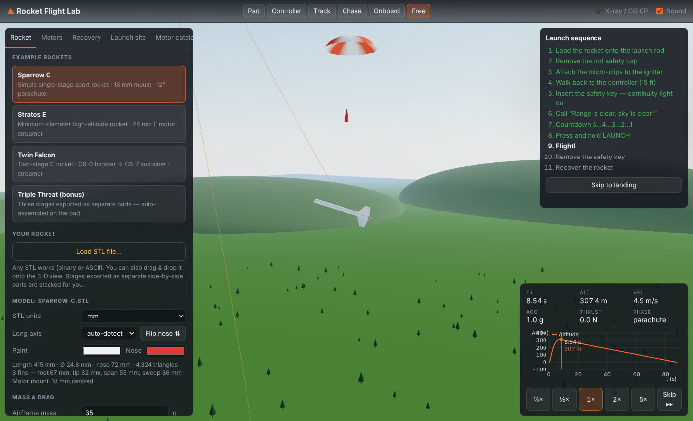

# Rocket Flight Lab

A browser-based 3-D model-rocket flight simulator. Load **any STL file** of a model
rocket, put real **A–F motors** in it (every delay variant, from certified thrust
curves), set it up on a detailed launch pad, then walk through the real
**ignition sequence on the launch controller** and watch it fly.



## Quick start

```bash
npm install
```

```bash
npm run dev
```

Open the printed URL (usually http://localhost:5173). `npm run build` makes a static
site in `dist/` that you can host anywhere, and `npm run build:single` also writes
`dist/rocket-flight-lab.html`, a single self-contained file with the example rockets
embedded. `npm test` runs the physics tests.

## What's in it

### Bring your own rocket (STL)
* Binary or ASCII STL, any orientation, mm / cm / m / inch (auto-guessed, editable).
* The analyzer slices the mesh to find the long axis, which end is the nose, the
  body-radius profile, nose length, **fin sets** (count, root/tip chord, span, sweep)
  and **motor-mount tubes** (13/18/24/29 mm, centred or clustered, including
  minimum-diameter rockets where the body tube *is* the motor tube).
* Motors are **placed for you** at the aft end of each stage, sized to the mount it
  finds. You can change motor, cluster count, how far the motor sticks out, and
  the stage joint positions.
* **Separated stages are assembled automatically.** If your STL has the stages
  side by side as separate pieces (the usual 3-D-printing layout), the app finds
  each piece, works out which is the sustainer (nose + fins) and which are boosters
  (fins + coupler stub), orders them bottom → top (largest fins at the bottom; you
  can re-order), seats each coupler stub into the stage above, and when you load the
  pad it **animates the stages being stacked onto the launch rod**. Stage joints
  and booster/sustainer motor placement come from the parts.
* Airframe mass is estimated from the model (override it if you weighed yours),
  plus optional nose weight. Drag Cd is computed (override available).
* Live CG/CP diagram and stability margin; an X-ray view shows motors, CG and CP
  inside the 3-D model.

### Motors — every A–F motor, every delay
`src/data/motors.generated.js` holds **91 motor variants built from 38 certified
thrust curves** (NAR/CAR/TRA certification data published on thrustcurve.org,
mirrored at [openrocket/motor-database](https://github.com/openrocket/motor-database);
the raw `.eng` files are in `data/eng/`). Each delay version is its own motor with
its own timing, mass and Estes label colour:

| Class | Motors |
|------|--------|
| 1/4A–1/2A | 1/4A3-3T, 1/2A3-2T/-4T, 1/2A6-2 |
| A | A3-4T, A10-0T/-3T/-PT, A8-3/-5 |
| B | B4-2/-4, B6-0/-2/-4/-6 |
| C | C5-3, C6-0/-3/-5/-7, C11-0/-3/-5/-7 |
| D | D11-P, D12-0/-3/-5/-7, AeroTech D13W, D15T, D21T, D24T |
| E | E9-0/-4/-6/-8, E12-0/-4/-6/-8, E16-0/-4/-6/-8, E30-4/-7, AeroTech E15W, E18W, E23T, E28T |
| F | F15-0/-4/-6/-8, F26FJ, F50, AeroTech F20W, F23FJ, F24W, F39T, F42T, F44W, F52T, F67W |

The **Motor catalog** tab lists them all with total impulse, % of class, average
and peak thrust, burn time, delay and mass, and overlays thrust curves for
comparison. You can import any other RASP `.eng` file too.

Burn behaviour is modelled the way real motors work: thrust follows the certified
curve, propellant mass drops in proportion to delivered impulse, the delay starts
at burnout (black-powder motors leave a tracking-smoke trail during it), and the
ejection charge fires at burnout + delay. `-0` booster motors fire straight
through into the next stage (direct staging); a booster with a delay, or a
composite motor, **won't** light the upper stage — just like real life.

### Play it like a real launch (first person)
You walk around the range yourself; nothing is locked into a sequence. The
checklist on the right only reminds you of the real procedure.

| Control | Action |
|---|---|
| `W A S D` / arrows, `Shift` | walk / run |
| click the view, mouse | look around (`Esc` frees the cursor; drag to look if your browser blocks pointer lock) |
| `E` | interact with what you're looking at / finish a close-up |
| mouse wheel, `Z` (hold) | zoom like binoculars |
| `T` | track assist: your view follows the rocket |
| `V` | cycle cameras: your eyes, chase, onboard, orbit |
| `C` | 5-4-3-2-1 countdown |
| holding the controller: right mouse or `K` | push and hold the safety key down |
| holding the controller: left mouse or `Space` | press and hold LAUNCH |
| `G` | put the controller down |
| `Tab` | show/hide the setup panel |

The procedure follows the Estes instructions:
1. **Prep table**: drag the Estes-style starter into the nozzle until it touches
   the propellant, push the plastic plug in to hold it, then click the leads to
   bend them apart.
2. Take the orange **safety cap** off the rod, pick the rocket up (separate
   stage parts are stacked in your hands) and slide it onto the rod.
3. At the pad, **drag each micro-clip onto a starter lead**, one per lead. The
   game blocks this if the safety key is in the controller.
4. Walk back the 17 ft (5.2 m) lead and **pick up the Electron Beam-style
   controller**: drag the key into the slot, push and hold it down (the LED lights
   only with good continuity), and while still holding the key press and hold
   LAUNCH. The LED goes out while current flows; the starter heats for about a
   second, then the motor lights. Let go too early and it cools off. With
   real-world variability on, the occasional starter misfires and has to be
   replaced.
5. Watch the flight from the ground with free look and zoom, take the key out,
   then walk to where it landed and press `E` to recover it.

The launch pad is modelled on the Estes Porta-Pad: tripod legs, tilt bracket
with wing nut, sooty blast deflector, two-piece 1/8" rod and rod cap.

### Smoke
Smoke puffs are laid down along the path the nozzle actually travels, so a fast
rocket leaves an unbroken trail. Each puff is pushed out by the exhaust, then
drifts with the wind (stronger with height), expands fast at first and then
keeps spreading, and thins out over 30 s or more. Black powder leaves a thick
grey-white trail and a thinner tracking-smoke trail during the delay. White
Lightning is dense white, Blue Thunder makes very little smoke, and Black Jack
is dark and sooty. At ignition a cloud rolls out across the blast deflector.

### Physics
* 3-D rigid body, RK4 integration (1 ms steps under power): thrust, gravity
  (varies with altitude), drag, normal force at the Barrowman centre of pressure,
  aerodynamic + jet pitch damping → realistic weathercocking.
* Centre of pressure: slender-body theory for the nose/transitions plus Barrowman
  fin equations with body interference, from the shapes found in your STL.
* Drag: component build-up (skin friction with Reynolds number and surface
  roughness, base drag that shrinks while the motor fires, fin trailing-edge drag,
  launch-lug/misc.) with compressibility correction.
* ISA atmosphere at your site elevation and temperature; wind with a 1/7-power
  height profile and gusts.
* Launch-rod guidance until the lug clears the rod; rod-exit speed reported.
* Staging, separated boosters tumbling back, ejection, parachute/streamer
  inflation and descent with wind drift.
* Optional real-world scatter: impulse ±3.5 %, delay ±10 %, igniter timing,
  cluster light-up stagger.

### Flight report
Apogee, max speed/Mach, max g, rod-exit speed, ejection speed/altitude, descent
rate, drift, events timeline, charts (altitude, velocity, acceleration,
thrust & mass, angle of attack & Mach, ground track) and plain-language warnings
(unstable, too-slow rod exit, early/late ejection with the ideal delay, hard landing,
staging problems).

## Example rockets (25)
All are real STL files in `public/examples/`, generated by `npm run build:examples`
from `tools/design-catalog.mjs`. Run `node tools/check-designs.mjs` to fly every
one and check stability, motor fit and recovery.

* **Starter**: Sparrow C (single stage), Stratos E (high altitude), Twin Falcon
  (two stage), Triple Threat (three separate stage parts).
* **Ultra crazy**: **HYDRA-5**, a five-stage rocket exported as five separate parts:
  3×D12-0 cluster booster → D12-0 → C6-0 → C6-0 → C6-7.
* **Original designs**: Needle (13 mm dart), Thunderhawk (fat 66 mm), Phantom Delta
  (delta fins + boattail, E30), Cluster Cub (3×C6), Payload Lifter (bulbous payload
  bay), Swept Viper (6 fins), Octo (8 fins), Brute (29 mm F15), Altitude Dart
  (F39 composite), Inverter (forward-swept fins).
* **Real Estes kits**: Alpha III, Big Bertha, Der Red Max, Comanche-3, Mean Machine,
  Mosquito, Wizard, V-2, Leviathan, Patriot M-104. Overall length, diameter, fin
  count, motor mount, recommended motor and kit weight come from Estes and retailer
  spec listings. Fin outlines and nose lengths are close approximations, because the
  exact kit templates aren't published.

## Graphics settings
Low / Medium / High / Ultra (top bar; remembered). Higher settings add shadows
(up to 4096² covering the range), drifting clouds, endless wind-swaying 3-D grass,
bloom on the sun/flames/LED, and on Ultra a cinematic colour grade (vignette, film
grain, chromatic fringe) and a sun lens flare. The field has mowing stripes, large-
scale grass variation, rolling farmland, a scorched dirt patch under the pad, a
windsock driven by the actual wind, a pop-up tent, chairs and a spectator flag line.

## Project layout
```
src/physics/   eng.js (RASP parser), motors.js, geometry.js (STL analysis + Barrowman),
               assembly.js (separated-parts stacking), atmosphere.js, simulator.js
src/scene/     world.js, launchPad.js, controller.js, rocketModel.js, effects.js
src/ui/        panel.js, charts.js, diagram.js
tools/         build-motors.mjs, motor-catalog.mjs, gen-examples.mjs
data/eng/      certified thrust curves
test/          node --test physics tests (npm test)
```

## Limitations
* Fin and body shapes are read from the mesh by slicing; very unusual geometry
  (ring fins, canted fins, pods, gliders) is approximated by an equivalent
  trapezoidal fin set. Roll is not simulated.
* Masses of delay variants made from one certified curve are adjusted by a small
  per-second delay-grain allowance.
* Model-rocket subsonic regime; the transonic drag rise is approximate.
